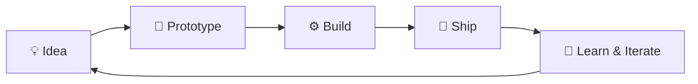

<!-- ============ HEADER ============ -->

 

---

## 👋 About Me

I'm a **B.Tech Information Technology** student at **PSG College of Technology** who loves building software that solves real problems. My work sits at the intersection of **creativity and engineering**: AI-powered video generation, secure identity systems for AI agents, mobile safety apps, and augmented reality.

> 💡 I don't just learn technologies. I experiment with them, build with them, and turn ideas into working applications.

---

## 🚀 Featured Projects

<table>
  <tr>
    <td width="50%" valign="top">
      <h3>🎬 AI Video Generation Engine</h3>
      Turns scripts and audio into narrated videos with automated B-roll selection, subtitles, and rendering.
        
      
      
      
      
        
      <a href="https://incubrix-video-broll-engine.vercel.app/">✨ Live Demo →</a>
    </td>
    <td width="50%" valign="top">
      <h3>🔎 Visibility Intelligence</h3>
      A dashboard for AEO, SEO, and GEO analytics, technical audits, evidence tracking, and content optimization.
        
      
      
      
      
        
      <a href="https://visibility-dashboard.onrender.com/">📊 Open Dashboard →</a>
    </td>
  </tr>
  <tr>
    <td width="50%" valign="top">
      <h3>🔐 AIMS: AI Agent Identity Management</h3>
      Authentication, scoped authorization, credential lifecycle management, and governance for AI agents.
        
      
      
      
      
        
      <a href="https://github.com/LakshmanDev12/AIMS---Vk">🔗 View Repository →</a>
    </td>
    <td width="50%" valign="top">
      <h3>🥽 Augmented Reality Experiences</h3>
      Interactive 3D experiences that connect real-world image markers with virtual models.
        
      
      
      
      
        
      <a href="https://github.com/LakshmanDev12/ALL-AR_Things">🔗 View Repository →</a>
    </td>
  </tr>
  <tr>
    <td width="50%" valign="top">
      <h3>📍 Sentriq: Personal Safety</h3>
      Mobile safety concepts with live location sharing, trusted guardians, geofencing, and SOS alerts.
        
      
      
      
        
      <a href="https://github.com/LakshmanDev12/Sentriq-by-Vk">🔗 View Repository →</a>
    </td>
    <td width="50%" valign="top">
      <h3>📱 Android Apps</h3>
      Mobile applications with Firebase integration, role-based access, scheduled reminders, and notifications.
        
      
      
      
        
      <a href="https://github.com/LakshmanDev12?tab=repositories">🔗 Browse Repositories →</a>
    </td>
  </tr>
</table>

---

## 🧰 Tech Stack

**💻 Languages**
 

**🌐 Frontend & Backend**
 

**📱 Mobile & AR**
 

**🗄️ Databases**
 

**🤖 AI, Data & Tools**
 

---

## 🧠 What Drives Me

| | Principle | In practice |
|---|---|---|
| 🛠️ | **Build** | Turn concepts into functional, shippable applications |
| 🔍 | **Explore** | Experiment with AI, automation, and emerging technologies |
| 🧩 | **Solve** | Strengthen problem-solving and engineering fundamentals |
| 📈 | **Improve** | Learn from every project, challenge, and iteration |
| 🤝 | **Collaborate** | Create useful products with people who enjoy building |

---

## 📊 GitHub Snapshot

---

## 🤝 Let's Build Something

I'm always open to **collaborations, internships, and interesting problems**. If you have an idea worth building, let's talk.

 

**⚡ Curious mind. Builder's mindset. Engineer in progress.**

<i>Every project is another opportunity to build something better.</i> 🚀

